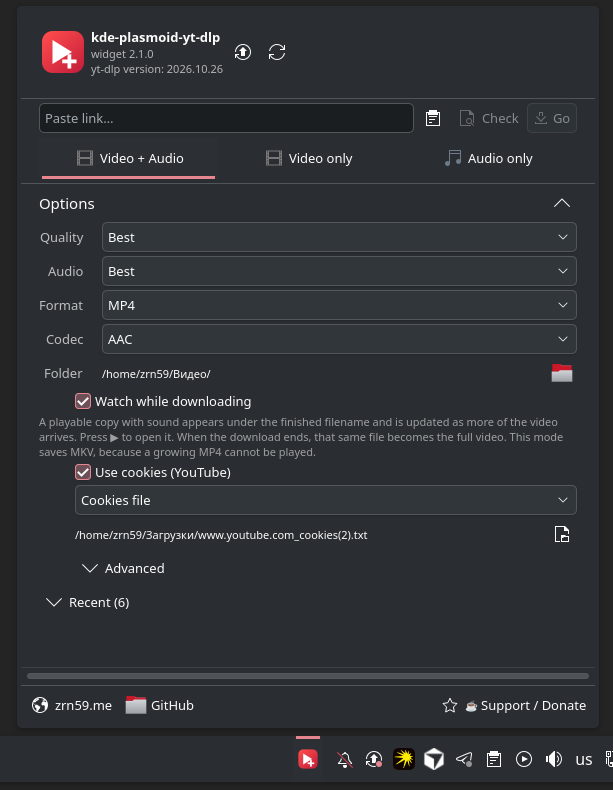
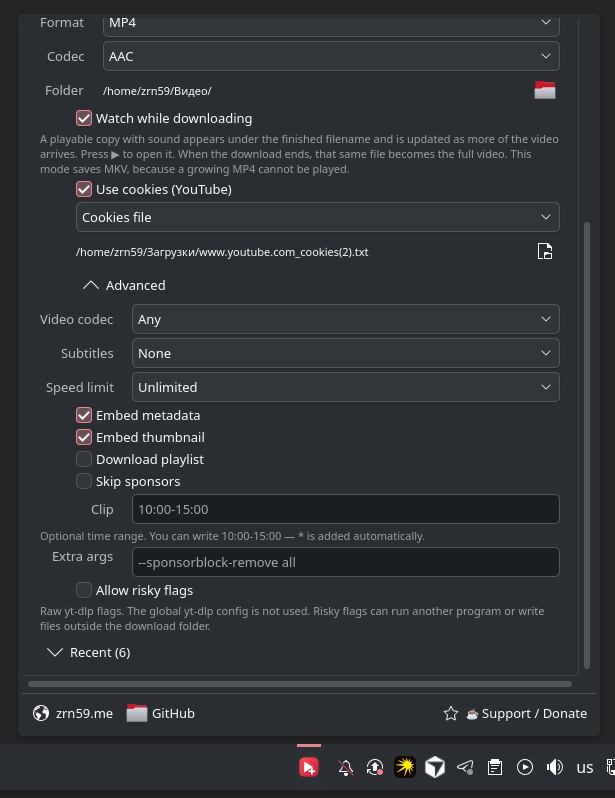
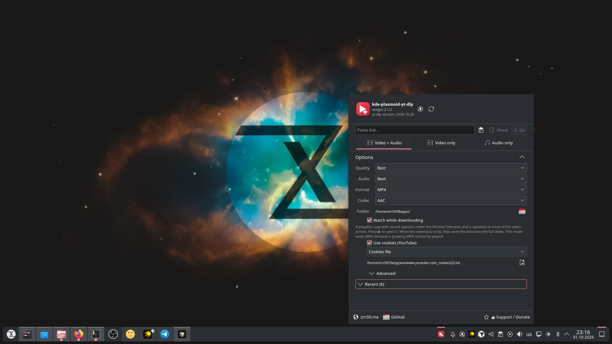

# kde-plasmoid-yt-dlp

<div align="center">

[English](README.md) · **Русский** · [Docs](docs/en/README.md) · [Документация](docs/README.md)

<br>

[](https://zrn59.me)
[](https://www.donationalerts.com/r/zrn59)
[](https://store.kde.org/p/2380466/)

*Custom Bot & Web Development • Data Parsing • Isolated Docker Hosting — **[zrn59.me](https://zrn59.me)***

</div>

---

<p align="center">
  <br>
  Окно виджета
</p>

<p align="center">
  <br>
  Дополнительные настройки
</p>

<p align="center">
  <br>
  Виджет на экране
</p>

Виджет панели KDE Plasma 6. Загрузка видео и аудио выполняется собственной копией [yt-dlp](https://github.com/yt-dlp/yt-dlp) из `~/.local/share/com.zrn59.ytdlp/`. Копия обновляется раз в сутки. Системный yt-dlp не заменяется.

Страница в [KDE Store](https://store.kde.org/p/2380466/).

## Установка

Самый простой способ:

```bash
bash -c "$(curl -fsSL https://raw.githubusercontent.com/Zrn59/kde-plasmoid-yt-dlp/main/install.sh)"
```

Требуется KDE Plasma 6. Права root не нужны. В меню: установка, обновление, починка, удаление. Из клона та же команда без загрузки: `./install.sh`.

Остальные способы зависят от системы. Пакет и `install.sh` одновременно не устанавливаются.

Добавление на панель: ПКМ по панели → Добавить виджеты → kde-plasmoid-yt-dlp. Если виджет уже был на панели, требуется новый вход в сессию.

| Система | Архитектура | Способ |
| --- | --- | --- |
| Ubuntu | amd64, arm64 | PPA |
| Debian 13 | amd64, arm64 | `.deb` из релиза |
| Arch Linux | x86_64, aarch64 | `.pkg.tar.*` из релиза |
| Fedora, openSUSE, прочие с Plasma 6 | amd64, arm64, x86_64, aarch64 | `install.sh` |

Файл `.deb` собран в Debian 13. На Ubuntu его зависимости не совпадают. При отсутствии сборки данного выпуска Ubuntu в PPA используется `install.sh`.

Архитектура определяется командами `dpkg --print-architecture` и `uname -m`. Имена `amd64` и `x86_64` обозначают одну архитектуру, `arm64` и `aarch64` — другую.

### Ubuntu

```bash
sudo add-apt-repository ppa:zrn59/kde-plasmoid-yt-dlp
sudo apt update
sudo apt install kde-plasmoid-yt-dlp
```

Обновление: `sudo apt upgrade`. В PPA присутствуют только выпуски Ubuntu, включённые на Launchpad.

### Debian 13, amd64

```bash
sudo apt install ./kde-plasmoid-yt-dlp_2.1.0-1_amd64.deb
```

### Debian 13, arm64

```bash
sudo apt install ./kde-plasmoid-yt-dlp_2.1.0-1_arm64.deb
```

Debian 12 и более ранние выпуски этот пакет не устанавливают. Следующая версия устанавливается новым файлом. `apt upgrade` файл из релиза не находит.

### Arch Linux, x86_64

```bash
sudo pacman -U kde-plasmoid-yt-dlp-2.1.0-1-x86_64.pkg.tar.zst
```

### Arch Linux, aarch64

```bash
sudo pacman -U kde-plasmoid-yt-dlp-2.1.0-1-aarch64.pkg.tar.xz
```

Пакета в AUR нет: регистрация временно закрыта 🥲

`pacman -Syu` установленный файл не обновляет. Следующая версия устанавливается новым файлом.

### Сборка из исходников

Пакеты компилятора перечислены в [docs/README.md](docs/README.md). Каталог виджета: `~/.local/share/plasma/plasmoids/`. Каталог yt-dlp: `~/.local/share/com.zrn59.ytdlp/bin/yt-dlp`. Путь `~/.local/bin/yt-dlp` не изменяется. Plasma перезапускается один раз.

```bash
./install.sh --skip-restart
./uninstall.sh
```

Для YouTube требуется Deno или Node. `install.sh` загружает Deno при отсутствии обоих. Пакеты apt и pacman Deno не устанавливают. `ffmpeg` и `curl` входят в зависимости пакета. Для `install.sh` эти программы устанавливаются заранее.

## Что умеет

- Видео и звук, только видео или только аудио
- Качество, кодек, контейнер, субтитры, лимит скорости и отрезок по времени
- Прогресс, пауза, продолжение и повтор
- Просмотр, пока видео ещё качается
- До пяти загрузок сразу
- Уведомления KDE
- Файл сохраняется по названию, например `Bad Apple!!.mp4`

Пакеты и PPA: [docs/packaging.md](docs/packaging.md).

Предложения по улучшению: [Discussions](https://github.com/Zrn59/kde-plasmoid-yt-dlp/discussions).

MIT. Текст в [LICENSE](LICENSE).
