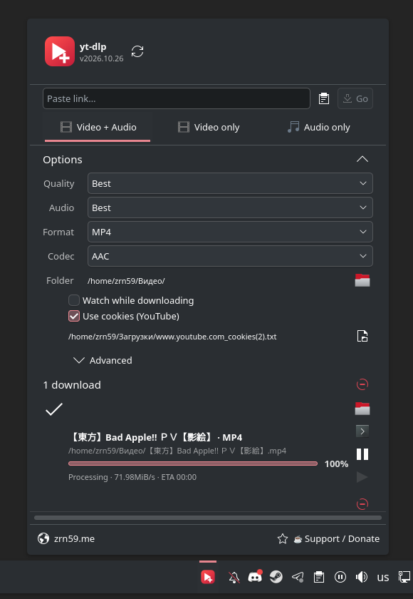

# Виджет yt-dlp для Plasma

<div align="center">

[English](README.md) · **Русский** · [Docs](docs/en/README.md) · [Документация](docs/README.md)

<br>

[](https://zrn59.me)
[](https://www.donationalerts.com/r/zrn59)

*Custom Bot & Web Development • Data Parsing • Isolated Docker Hosting — **[zrn59.me](https://zrn59.me)***

</div>

---

<p align="center">
  
</p>

Виджет панели для KDE Plasma 6. Качает видео и аудио своей копией [yt-dlp](https://github.com/yt-dlp/yt-dlp).

```bash
./install.sh
```

ПКМ по панели → **Добавить виджеты** → **yt-dlp**.

Установка, зависимости и возможности: [Документация](docs/README.md).

MIT. Текст в [LICENSE](LICENSE).
